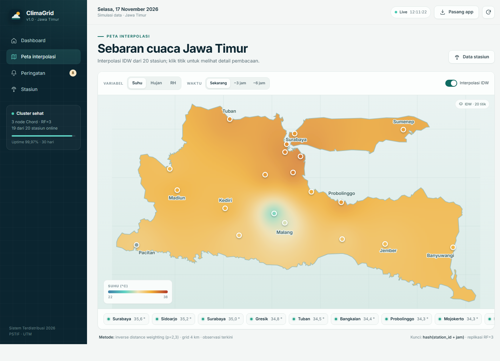
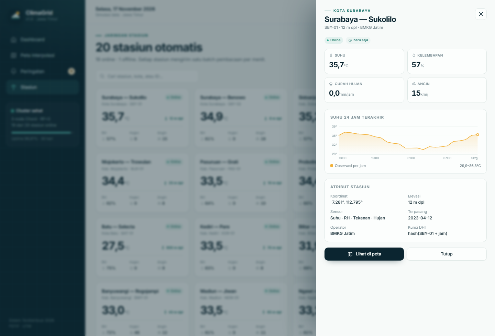

<div align="center">
  

  <h1>ClimaGrid</h1>

  <p><strong>Dashboard cuaca &amp; iklim terdistribusi untuk Jawa Timur</strong><br />
  PWA offline-first dengan peta interpolasi IDW, peringatan dini, dan 20 stasiun otomatis.</p>

  
  
  
  
  
  
</div>


## Tentang

**ClimaGrid** adalah purwarupa antarmuka untuk sistem pemantauan cuaca dan iklim
terdistribusi di Jawa Timur. Proyek ini dikembangkan dari PRD *ClimaGrid v1.0 —
Sistem Terdistribusi 2026* dan berfokus pada tiga kebutuhan utama:

1. **Dashboard** ringkasan kondisi wilayah.
2. **Peta interpolasi** sebaran suhu, hujan, dan kelembapan.
3. **Peringatan dini** berbasis ambang batas per stasiun.

Versi ini adalah **demo front-end tanpa backend**. Seluruh pembacaan sensor
disimulasikan secara deterministik di browser, sehingga aplikasi bisa langsung
dijalankan, dipasang sebagai PWA, dan didemokan tanpa database atau API.

> Data pada demo ini **bukan data BMKG**. Nama stasiun, koordinat, dan nilai
> pembacaan disusun untuk keperluan demonstrasi.

## Fitur

| Modul | Isi |
| --- | --- |
| **Dashboard** | Suhu rata-rata wilayah, ringkasan peringatan, 4 KPI, grafik suhu 24 jam, grafik curah hujan, stasiun terpanas |
| **Peta interpolasi** | Sebaran suhu/hujan/RH dengan *inverse distance weighting*, batas Jawa Timur, label kota, pilihan waktu, toggle interpolasi, legenda |
| **Peringatan** | Deteksi suhu ekstrem, hujan lebat, udara kering, dan angin kencang; filter prioritas dan riwayat selesai |
| **Stasiun** | 20 stasiun, pencarian, filter online/offline, sheet detail berisi grafik 24 jam dan atribut stasiun |
| **Live simulation** | Nilai diperbarui tiap 5 detik, jam berjalan, tanpa perlu server data |
| **PWA** | Manifest, ikon, service worker, dapat dipasang ke layar utama, dan tetap terbuka saat offline |
| **Responsif** | Sidebar di desktop, tab bar bawah dan bottom sheet di ponsel |

## Tangkapan layar

| Peta interpolasi | Peringatan dini |
| --- | --- |
|  |  |

<p align="center">
  
  
</p>



## Menjalankan secara lokal

### Prasyarat

- [Node.js](https://nodejs.org) 18 atau lebih baru
- Browser modern (Chrome, Edge, Firefox, Safari)

Tidak ada dependensi npm dan tidak ada proses build.

### Langkah

```bash
git clone https://github.com/<username>/climagrid.git
cd climagrid
node server.js
```

Buka **http://localhost:4173**.

Di Windows, kamu juga bisa **klik dua kali `Jalankan ClimaGrid.bat`** — server
langsung berjalan dan browser terbuka otomatis.

> Gunakan `node server.js`, bukan membuka `index.html` lewat `file://`.
> Service worker, mode offline, dan tombol pemasangan hanya aktif saat aplikasi
> diakses melalui HTTP/HTTPS.
>
> Jika PowerShell menolak `npm start` dengan pesan *running scripts is
> disabled*, gunakan `node server.js` atau `npm.cmd start`.

### Mengakses dari ponsel

1. Hubungkan ponsel dan komputer ke Wi-Fi yang sama.
2. Jalankan server, lalu salin alamat **Jaringan** yang tampil di terminal,
   misalnya `http://192.168.1.10:4173`.
3. Buka alamat tersebut di browser ponsel.
4. Jika tidak bisa terhubung, izinkan Node.js pada firewall Windows.

## Memasang sebagai aplikasi

**Android (Chrome/Edge)**

1. Buka aplikasi melalui `http://localhost:4173` atau alamat LAN.
2. Ketuk tombol **Pasang app** di kanan atas, atau menu **⋮ → Instal aplikasi**.
3. Konfirmasi. Ikon ClimaGrid akan muncul di launcher.

**iPhone/iPad (Safari)**

1. Buka aplikasi di Safari.
2. Ketuk **Bagikan → Tambahkan ke Layar Utama**.

## Struktur proyek

```text
climagrid-app/
├─ index.html              # Shell PWA + ikon SVG sprite
├─ styles.css              # Design system dan layout responsif
├─ app.js                  # Routing, chart, peta IDW, peringatan, live loop
├─ data.js                 # 20 stasiun, label kota, variabel, ambang batas
├─ map-data.js             # Poligon Jawa Timur hasil penyederhanaan
├─ manifest.webmanifest    # Metadata pemasangan PWA
├─ sw.js                   # Service worker (cache app shell)
├─ server.js               # Server statis tanpa dependensi
├─ Jalankan ClimaGrid.bat  # Launcher Windows
├─ icons/                  # Ikon 192/512/maskable/apple/favicon
├─ assets/fonts/           # Inter 400/600/700/800
└─ docs/screenshots/       # Gambar untuk README
```

## Data simulasi & ambang batas

Data dibangkitkan dari nilai dasar tiap stasiun, lalu dimodulasi dengan siklus
harian dan variasi deterministik. Dari 20 stasiun, **19 online** dan **1
offline** (`PKT-01`) untuk memperlihatkan penanganan data basi.

Aturan peringatan berada di `ALERT_RULES` pada `data.js`:

| Aturan | Variabel | Tinggi | Sedang |
| --- | --- | ---: | ---: |
| Suhu ekstrem | Suhu | ≥ 35 °C | ≥ 34,5 °C |
| Hujan lebat | Curah hujan | ≥ 40 mm/jam | ≥ 20 mm/jam |
| Udara kering | Kelembapan | ≤ 35 % | ≤ 42 % |
| Angin kencang | Kecepatan angin | ≥ 40 km/jam | ≥ 30 km/jam |

Ubah nilai tersebut untuk menguji skenario lain. Nilai awal sengaja disusun
agar muncul contoh peringatan: panas di Surabaya, hujan lebat di Banyuwangi,
udara kering di Tuban, dan angin kencang di Sumenep.

## Peta & interpolasi

- Batas wilayah berasal dari **geoBoundaries** (OpenStreetMap, ODbL 1.0),
  disederhanakan dengan algoritma Ramer–Douglas–Peucker.
- Interpolasi memakai **inverse distance weighting** dengan bobot
  `1 / (d² + ε)` dan koreksi jarak horizontal terhadap garis lintang.
- Permukaan interpolasi digambar ke canvas 190×112, lalu dijadikan *overlay*
  yang dipotong sesuai poligon wilayah.
- Pilihan waktu **−3 jam** dan **−6 jam** memakai riwayat 24 jam per stasiun.

Versi produksi sesuai PRD menjalankan interpolasi sebagai job MPI di cluster,
dengan data dari TimescaleDB dan replikasi Chord `RF=3`. Demo ini menirukan
narasi tersebut di sisi klien agar ringan dan bisa berjalan offline.

## PWA & mode offline

- `sw.js` menyimpan app shell (HTML, CSS, JS, font, ikon) dengan cache
  berversi.
- Navigasi memakai strategi *network-first* dengan fallback ke `index.html`.
- Aset statis memakai *cache-first*.
- Saat mengubah aset, naikkan `VERSION` di `sw.js` agar cache lama dibersihkan.

## Deploy ke GitHub Pages

Karena aplikasi berupa berkas statis, GitHub Pages bisa dipakai langsung.

1. Jadikan **isi folder ini** sebagai root repositori (bukan folder induknya).
2. Push ke GitHub:
   ```bash
   git init
   git add .
   git commit -m "feat: ClimaGrid PWA"
   git branch -M main
   git remote add origin https://github.com/<username>/climagrid.git
   git push -u origin main
   ```
3. Buka **Settings → Pages**, pilih **Deploy from a branch**, branch `main`,
   folder `/ (root)`.
4. Aplikasi tersedia di `https://<username>.github.io/climagrid/`.

Seluruh path di proyek bersifat relatif, sehingga tetap berjalan di subpath
GitHub Pages. Alternatif lain: Netlify, Vercel, atau Cloudflare Pages dengan
*base directory* di folder ini dan tanpa build command.

## Pengujian

Checklist yang sudah diverifikasi pada Chrome:

- [x] Manifest valid dan dapat dipasang (0 installability error).
- [x] Service worker aktif; reload dalam mode offline tetap menampilkan app.
- [x] Tidak ada error JavaScript di console.
- [x] Dashboard, peta, peringatan, dan stasiun merender dengan benar.
- [x] Filter peringatan, pencarian stasiun, ganti variabel peta, dan toggle IDW.
- [x] Sheet detail stasiun dan aksi “Lihat di peta”.
- [x] Layout 390 px tanpa overflow horizontal; tab bar dan bottom sheet aktif.
- [x] Mode offline menampilkan bilah informasi dan data simulasi tetap berjalan.

## Keterbatasan

- Belum ada backend, autentikasi, atau pengiriman data sensor nyata.
- Data dan peringatan adalah simulasi, bukan keluaran model cuaca.
- Interpolasi dijalankan di klien dengan resolusi rendah.
- Untuk distribusi sebagai file `.apk`, PWA dapat dibungkus menjadi **TWA**
  (Trusted Web Activity) dengan Bubblewrap setelah di-hosting di HTTPS.

## Kontribusi

Issue dan pull request terbuka. Untuk perubahan besar, buka issue terlebih
dahulu agar arahnya bisa didiskusikan. Pastikan tidak menambahkan dependensi
tanpa alasan yang jelas dan tetap menjaga aplikasi dapat berjalan tanpa build.

## Kredit & lisensi

- **Inter** — SIL Open Font License 1.1.
- **Batas wilayah** — [geoBoundaries](https://www.geoboundaries.org/)
  (OpenStreetMap, ODbL 1.0).
- Ikon aplikasi dibuat khusus untuk proyek ini.
- Kode aplikasi dilisensikan di bawah [MIT License](LICENSE).

---

<p align="center"><sub>Dibuat untuk mata kuliah Sistem Terdistribusi · PSTIF · UTM · 2026</sub></p>
