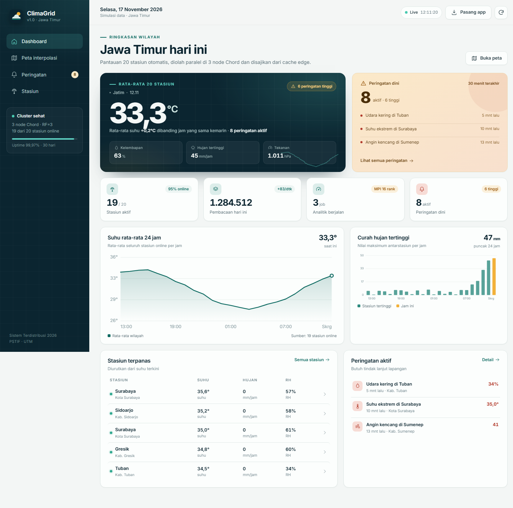
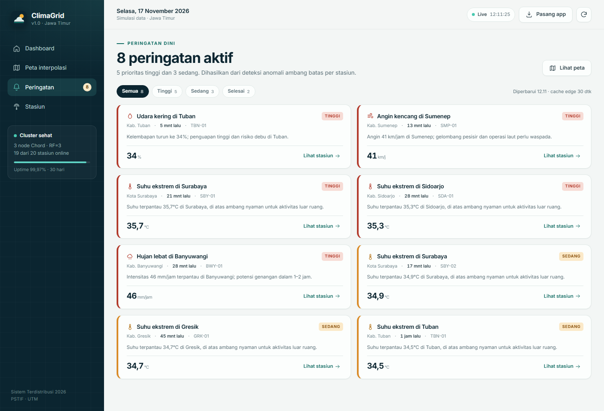
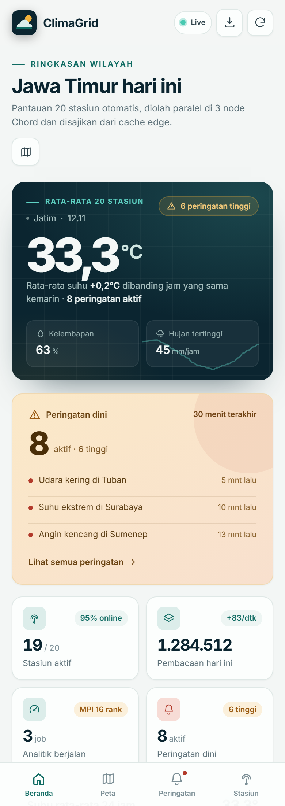
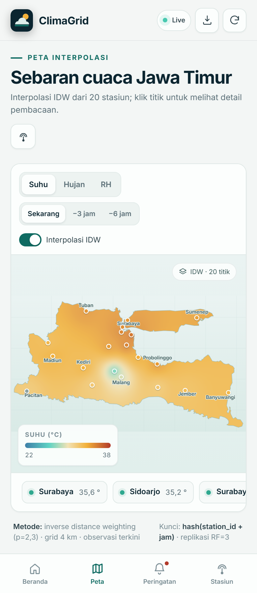

<div align="center">
  

  <h1>ClimaGrid</h1>

  <p><strong>Dashboard cuaca &amp; iklim terdistribusi untuk Jawa Timur</strong><br />
  PWA offline-first dengan peta interpolasi IDW, peringatan dini, dan 20 stasiun otomatis.</p>

  
  
  
  
  
  
</div>



## Tentang

**ClimaGrid** adalah purwarupa lokal untuk sistem pemantauan cuaca dan iklim
terdistribusi di Jawa Timur. Proyek ini dikembangkan dari PRD *ClimaGrid v1.0 —
Sistem Terdistribusi 2026* dan menyertakan PWA tanpa build step serta backend
Node.js yang bisa dijalankan lokal:

1. **Dashboard** ringkasan kondisi wilayah.
2. **Peta interpolasi** sebaran suhu, hujan, dan kelembapan.
3. **Peringatan dini** berbasis ambang batas per stasiun.

Tanpa backend, antarmuka menggunakan data simulasi dan menampilkan label
**Mode simulasi**. Saat backend tersedia, peta, peringatan, pencarian stasiun,
dan histori pembacaan diminta dari API.

> Data pada demo ini **bukan data BMKG**. Nama stasiun, koordinat, dan nilai
> pembacaan disusun untuk keperluan demonstrasi.

## Fitur

| Modul | Isi |
| --- | --- |
| **Dashboard** | Suhu rata-rata wilayah, ringkasan peringatan, 4 KPI, grafik suhu 24 jam, grafik curah hujan, stasiun terpanas |
| **Peta interpolasi** | Sebaran suhu/hujan/RH dengan *inverse distance weighting*, batas Jawa Timur, label kota, pilihan waktu, toggle interpolasi, legenda |
| **Peringatan** | Deteksi suhu ekstrem, hujan lebat, udara kering, dan angin kencang; filter prioritas dan riwayat selesai |
| **Stasiun** | 20 stasiun, pencarian, filter online/offline, sheet detail berisi grafik 24 jam dan atribut stasiun |
| **Backend lokal** | REST, gRPC Node.js, antrean job, JSON persisten, DHT lokal, LRU/lease, dan serial fallback analytics |
| **Mode simulasi** | Fallback deterministik dengan label eksplisit bila backend tidak terjangkau |
| **PWA** | Manifest, ikon, service worker, dapat dipasang ke layar utama, dan tetap terbuka saat offline |
| **Responsif** | Sidebar di desktop, tab bar bawah dan bottom sheet di ponsel |

## Tangkapan layar

| Peta interpolasi | Peringatan dini |
| --- | --- |
|  |  |

<p align="center">
  
  
</p>


## Menjalankan secara lokal

### Prasyarat

- [Node.js](https://nodejs.org) 18 atau lebih baru
- Browser modern (Chrome, Edge, Firefox, Safari)

Dependensi backend dikelola dengan npm. Frontend tidak memerlukan proses build.

### Langkah

```bash
git clone https://github.com/<username>/climagrid.git
cd climagrid
npm install
node server.js
```

Buka **http://localhost:4173**.

Di Windows, kamu juga bisa **klik dua kali `Jalankan ClimaGrid.bat`** — server
langsung berjalan dan browser terbuka otomatis.

> Gunakan `node server.js`, bukan membuka `index.html` lewat `file://`.
> Service worker, mode offline, dan tombol pemasangan hanya aktif saat aplikasi
> diakses melalui HTTP/HTTPS.
>
> Jika PowerShell menolak `npm start` dengan pesan *running scripts is
> disabled*, gunakan `node server.js` atau `npm.cmd start`.

### Mengakses dari ponsel

1. Hubungkan ponsel dan komputer ke Wi-Fi yang sama.
2. Jalankan server, lalu salin alamat **Jaringan** yang tampil di terminal,
   misalnya `http://192.168.1.10:4173`.
3. Buka alamat tersebut di browser ponsel.
4. Jika tidak bisa terhubung, izinkan Node.js pada firewall Windows.

## Memasang sebagai aplikasi

**Android (Chrome/Edge)**

1. Buka aplikasi melalui `http://localhost:4173` atau alamat LAN.
2. Ketuk tombol **Pasang app** di kanan atas, atau menu **⋮ → Instal aplikasi**.
3. Konfirmasi. Ikon ClimaGrid akan muncul di launcher.

**iPhone/iPad (Safari)**

1. Buka aplikasi di Safari.
2. Ketuk **Bagikan → Tambahkan ke Layar Utama**.

## Struktur proyek

```text
climagrid-app/
├─ index.html              # Shell PWA + ikon SVG sprite
├─ styles.css              # Design system dan layout responsif
├─ app.js                  # Routing, peta API, peringatan, histori, fallback UI
├─ data.js                 # 20 stasiun, label kota, variabel, ambang batas
├─ map-data.js             # Poligon Jawa Timur hasil penyederhanaan
├─ manifest.webmanifest    # Metadata pemasangan PWA
├─ sw.js                   # Service worker (cache app shell)
├─ server.js               # REST gateway dan server HTTP/HTTPS
├─ backend/                # Gateway, ingest, master/worker, DHT, store, RPC/cache
├─ analytics/              # MPI IDW dan statistik dengan fallback serial
├─ proto/                  # Kontrak protobuf untuk gRPC Node.js
├─ db/schema.sql           # Skema PostgreSQL/TimescaleDB (belum adapter aktif)
├─ tests/                  # API, persistensi, DHT, RPC, cache, observability, load
├─ Jalankan ClimaGrid.bat  # Launcher Windows
├─ icons/                  # Ikon 192/512/maskable/apple/favicon
├─ assets/fonts/           # Inter 400/600/700/800
└─ docs/screenshots/       # Gambar untuk README
```

## Data simulasi & ambang batas

Data dibangkitkan dari nilai dasar tiap stasiun, lalu dimodulasi dengan siklus
harian dan variasi deterministik. Dari 20 stasiun, **19 online** dan **1
offline** (`PKT-01`) untuk memperlihatkan penanganan data basi.

Aturan peringatan berada di `ALERT_RULES` pada `data.js`:

| Aturan | Variabel | Tinggi | Sedang |
| --- | --- | ---: | ---: |
| Suhu ekstrem | Suhu | ≥ 35 °C | ≥ 34,5 °C |
| Hujan lebat | Curah hujan | ≥ 40 mm/jam | ≥ 20 mm/jam |
| Udara kering | Kelembapan | ≤ 35 % | ≤ 42 % |
| Angin kencang | Kecepatan angin | ≥ 40 km/jam | ≥ 30 km/jam |

Ubah nilai tersebut untuk menguji skenario lain. Nilai awal sengaja disusun
agar muncul contoh peringatan: panas di Surabaya, hujan lebat di Banyuwangi,
udara kering di Tuban, dan angin kencang di Sumenep.

## Peta & interpolasi

- Batas wilayah berasal dari **geoBoundaries** (OpenStreetMap, ODbL 1.0),
  disederhanakan dengan algoritma Ramer–Douglas–Peucker.
- Interpolasi memakai **inverse distance weighting** dengan bobot
  `1 / (d² + ε)` dan koreksi jarak horizontal terhadap garis lintang.
- Permukaan interpolasi digambar ke canvas 190×112, lalu dijadikan *overlay*
  yang dipotong sesuai poligon wilayah.
- Pilihan waktu **−3 jam** dan **−6 jam** memakai riwayat 24 jam per stasiun.

Versi produksi sesuai PRD menjalankan interpolasi sebagai job MPI di cluster,
dengan data dari TimescaleDB dan replikasi Chord `RF=3`. Demo ini menirukan
narasi tersebut di sisi klien agar ringan dan bisa berjalan offline.

## PWA & mode offline

- `sw.js` menyimpan app shell (HTML, CSS, JS, font, ikon) dengan cache
  berversi.
- Navigasi memakai strategi *network-first* dengan fallback ke `index.html`.
- Aset statis memakai *cache-first*.
- Saat mengubah aset, naikkan `VERSION` di `sw.js` agar cache lama dibersihkan.

## Deploy ke GitHub Pages

Karena aplikasi berupa berkas statis, GitHub Pages bisa dipakai langsung.

1. Jadikan **isi folder ini** sebagai root repositori (bukan folder induknya).
2. Push ke GitHub:
   ```bash
   git init
   git add .
   git commit -m "feat: ClimaGrid PWA"
   git branch -M main
   git remote add origin https://github.com/<username>/climagrid.git
   git push -u origin main
   ```
3. Buka **Settings → Pages**, pilih **Deploy from a branch**, branch `main`,
   folder `/ (root)`.
4. Aplikasi tersedia di `https://<username>.github.io/climagrid/`.

Seluruh path di proyek bersifat relatif, sehingga tetap berjalan di subpath
GitHub Pages. Hosting statis tidak menjalankan `server.js`; API tidak tersedia
dan PWA menampilkan **Mode simulasi**. Untuk fitur backend, jalankan/deploy
server Node.js. Alternatif hosting statis: Netlify, Vercel, atau Cloudflare
Pages dengan *base directory* di folder ini dan tanpa build command.

## REST API backend lokal

Backend menyediakan API REST, transport gRPC Node.js lokal, antrean job, DHT
Chord in-process, cache LRU, dan penyimpanan JSON persisten. Data stasiun berasal
dari `data/stations.json`; state tersimpan pada `data/backend-state.json`.
Endpoint API mendukung validasi, token Bearer opsional, rate limit, ETag,
Conditional GET, dan idempotency key.

```text
GET  /api/v1/stations
GET  /api/v1/stations/{station_id}/readings
POST /api/v1/stations/{station_id}/readings
POST /api/v1/analytics/jobs
GET  /api/v1/analytics/jobs/{job_id}
GET  /api/v1/maps/{variable}?time=
GET  /api/v1/alerts?wilayah=
DELETE /api/v1/analytics/jobs/{job_id}
GET  /api/v1/health
GET  /metrics
```

`GET /api/v1/stations` mendukung filter `provinsi`, `sensor`, `type`, `operator`,
`status`, dan pencarian `q`. Endpoint debug DHT/worker dan trace hanya aktif
bila `CLIMAGRID_ENABLE_DEBUG=true`; jangan aktifkan debug endpoint pada server
yang terekspos ke jaringan publik.

Untuk mengaktifkan autentikasi:

```powershell
$env:CLIMAGRID_TOKEN="ganti-dengan-token-rahasia"
node server.js
```

Jalankan server (`node server.js`) lalu pengujian API:

```powershell
node tests/api.test.js
node tests/cache.test.js
node tests/rpc.test.js
node tests/persistence.test.js
node tests/dht.test.js
node tests/dht-api.test.js
node tests/mpi.test.js
node tests/observability.test.js
node tests/load-failover.test.js
```

Hasil terakhir pada host lokal:

```text
API tests passed
Edge cache LRU and lease tests passed
gRPC ingest/read/job/result/alert tests passed
Persistence and restart tests passed
DHT quorum, repair, handoff, and lookup tests passed
DHT endpoint failover test passed
Analytics worker tests passed (serial-fallback; MPI runtime available: false)
Prometheus metrics and gateway-ingest-DHT trace tests passed
Ingest API p95=43.94 ms; warm map p95=13.38 ms
Submit job p95=65.88 ms; Chord lookup p95=14.82 ms
Synthetic 5,000-station index: 1,667 matched; build+query=64.25 ms
DHT/worker failover and duplicate-execution checks passed
```

Angka latensi di atas merupakan pengukuran lokal dengan sampel kecil, bukan
jaminan SLA produksi. Uji 5.000 hanya membangkitkan data sintetis untuk indeks
atribut; bukan uji throughput 5.000 stasiun.

### HTTPS lokal

HTTPS opsional dikendalikan oleh `HTTPS_PORT`. Buat sertifikat self-signed
Windows dan jalankan server dengan PFX:

```powershell
$password = Read-Host "PFX password" -AsSecureString
.\tools\create-self-signed-cert.ps1 -OutputPath "$env:LOCALAPPDATA\ClimaGrid\climagrid-dev.pfx" -Password $password
$env:HTTPS_PFX = "$env:LOCALAPPDATA\ClimaGrid\climagrid-dev.pfx"
$env:HTTPS_PFX_PASSWORD = "password-yang-sama"
$env:HTTPS_PORT = "4443"
node server.js
```

Server juga menerima `HTTPS_KEY` dan `HTTPS_CERT` untuk pasangan PEM.
Sertifikat self-signed hanya untuk pengujian lokal; HTTPS REST tidak
mengaktifkan TLS/mTLS pada transport gRPC internal.

### Observability dan topologi lokal

- `GET /metrics` menampilkan histogram latensi HTTP, hitungan ingest/duplikat,
  hit/miss cache, dan status node DHT dalam format Prometheus.
- Header `X-Trace-Id` menghubungkan span gateway → ingest → DHT; buffer trace
  lokal tersedia di endpoint debug saat debug diaktifkan.
- Port default: HTTP `4173`, gRPC internal `8443`; HTTPS hanya aktif jika
  `HTTPS_PORT` disetel.
- PostgreSQL/TimescaleDB, Redis, Docker, dan OpenTelemetry belum menjadi
  layanan aktif di konfigurasi lokal. Saat ini gunakan file JSON dan LRU.
- Topologi yang diuji adalah satu host: browser → HTTP/HTTPS gateway → gRPC
  lokal → modul ingest/master/worker/DHT. Untuk demo LAN, batasi firewall ke
  port HTTP/HTTPS dari subnet klien; jangan buka port gRPC `8443` ke Internet.
  VLAN/DMZ dan aturan firewall produksi belum dideploy atau diuji.

## Pengujian

Checklist yang sudah diverifikasi pada Chrome:

- [x] Manifest valid dan dapat dipasang (0 installability error).
- [x] Service worker aktif; reload dalam mode offline tetap menampilkan app.
- [x] Tidak ada error JavaScript di console.
- [x] Dashboard, peta, peringatan, dan stasiun merender dengan benar.
- [x] Filter peringatan, pencarian stasiun, ganti variabel peta, dan toggle IDW.
- [x] Sheet detail stasiun dan aksi “Lihat di peta”.
- [x] Layout 390 px tanpa overflow horizontal; tab bar dan bottom sheet aktif.
- [x] Mode offline menampilkan bilah informasi dan data simulasi tetap berjalan.

## Keterbatasan dan status

- Data stasiun/seed bukan data BMKG atau keluaran model cuaca. Ingest lokal
  hanya menyimpan data yang dikirim ke API.
- Penyimpanan aktif adalah JSON, bukan PostgreSQL/TimescaleDB; `db/schema.sql`
  belum menjadi database yang dijalankan.
- Redis client tersedia, tetapi tanpa Redis server yang dapat diuji aplikasi
  memakai LRU in-memory.
- MPI multi-rank N=2/4 belum diuji karena `mpi4py`/`mpiexec` tidak tersedia;
  hasil terverifikasi memakai serial fallback.
- DHT dan worker diuji dalam satu proses lokal, bukan cluster lintas mesin.
- HTTPS opsional diuji dengan sertifikat self-signed; gRPC TLS/mTLS,
  OpenTelemetry/Grafana, Docker, VLAN, DMZ, dan firewall produksi belum ada.
- Uji 5.000 stasiun bersifat sintetis dan terbatas pada indeks atribut.
- Untuk distribusi sebagai file `.apk`, PWA dapat dibungkus menjadi **TWA**
  (Trusted Web Activity) setelah di-hosting di HTTPS.

## Kontribusi

Issue dan pull request terbuka. Untuk perubahan besar, buka issue terlebih
dahulu agar arahnya bisa didiskusikan. Pastikan tidak menambahkan dependensi
tanpa alasan yang jelas dan tetap menjaga aplikasi dapat berjalan tanpa build.

## Kredit & lisensi

- **Inter** — SIL Open Font License 1.1.
- **Batas wilayah** — [geoBoundaries](https://www.geoboundaries.org/)
  (OpenStreetMap, ODbL 1.0).
- Ikon aplikasi dibuat khusus untuk proyek ini.
- Kode aplikasi dilisensikan di bawah [MIT License](LICENSE).

---

<p align="center"><sub>Dibuat untuk mata kuliah Sistem Terdistribusi · PSTIF · UTM · 2026</sub></p>
